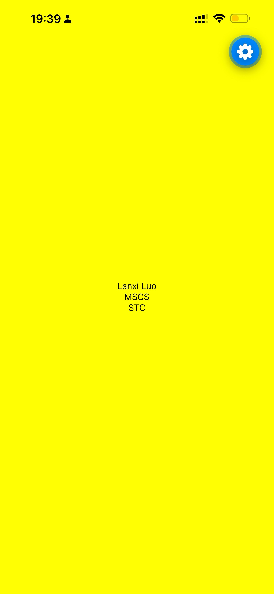

# Input
Honestly, there isn't really any user input. Nobody types or taps anything. What the app works with is just the data I put into App.js myself: my name, my degree program (MSCS), and my school (STC). Those three strings are hard-coded into three Text components - so they stay the same every time.

# Process
Running "npx expo start --tunnel" starts Metro - it bundles App.js and pushes it through the tunnel to Expo Go on my iPhone. Then React Native renders App. The View is the container, and its style comes from StyleSheet.create(). flex: 1 makes it fill the screen. backgroundColor turns it yellow. alignItems and justifyContent both set to center put things in the middle - one handles horizontal, the other vertical, I think. The three Text components live inside the View, so they just follow its layout. Kind of like a div with some CSS.

# Output
A full yellow screen, with Lanxi Luo, MSCS, and STC stacked in the middle. It looked a bit plain at first - but that's pretty much what the sample showed too.

