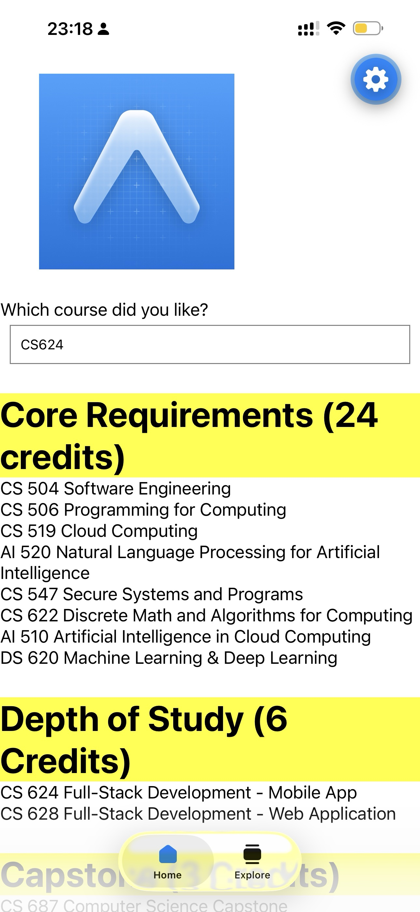
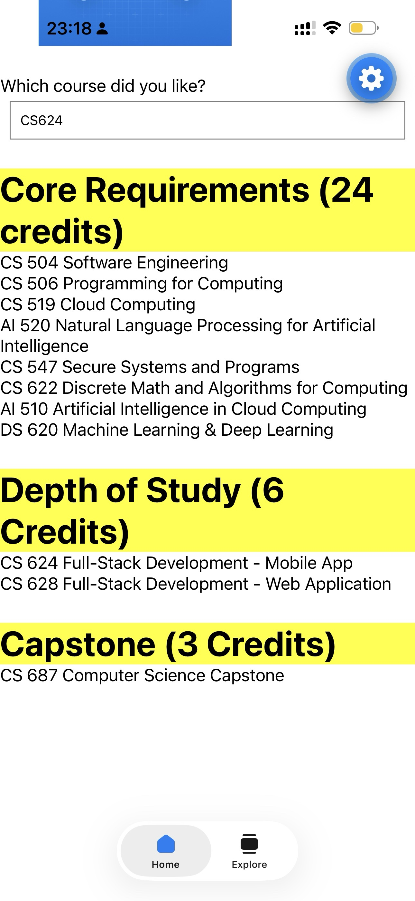

# Input

To be fair, the main input is the course catalog. I took the 8 core, 2 depth of study, and 1 capstone courses from CityU's 2026-2027 catalog and hard-coded them as Text. Beyond that, the app loads icon.png from assets/images with require(), and the user can type a favorite course, like "CS624," into the TextInput.

# Process

App is an arrow function component that returns JSX. A ScrollView wraps everything so the page scrolls, View blocks group each section, and every course is its own Text. The styles all live in one StyleSheet.create object in the same file - an internal style. I added extra bottom padding, too, since the tab bar kept covering the capstone.

# Output

The screen shows the icon, the input box, and three yellow-headed course sections, ending with the CS 687 capstone. Whatever you type just stays in the box. Maybe that's the next step: actually doing something with it.

