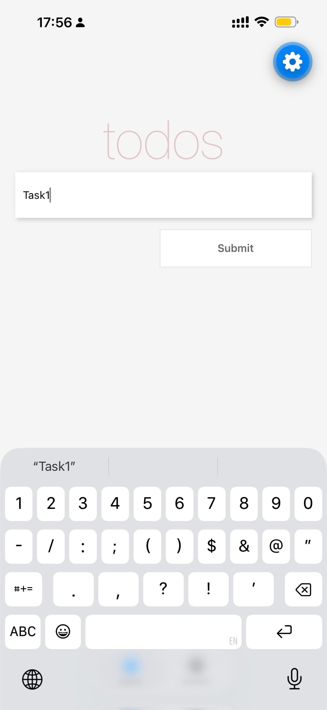
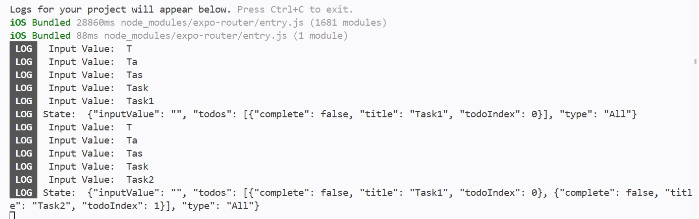

# Input

The input here is pretty small. The user types a task, like "Task1," into the TextInput and taps Submit. The app also starts with three state values - inputValue, todos, and type - set up in App's constructor, carried over from HOS03.

# Process

Every keystroke calls inputChange, which logs the text and updates inputValue with setState. Tapping Submit runs submitTodo - I bound it to App in the constructor so "this" doesn't get lost when the Button calls it. It quietly skips blank input with a regex, builds a todo object with a title, a todoIndex, and complete: false, then adds it to the end of the array with the spread operator. setState clears the box, and its callback logs the new state.

# Output

The input box empties after each submit, and the terminal prints the updated todos array. Nothing shows on screen yet - I think that's coming in Part 2.

