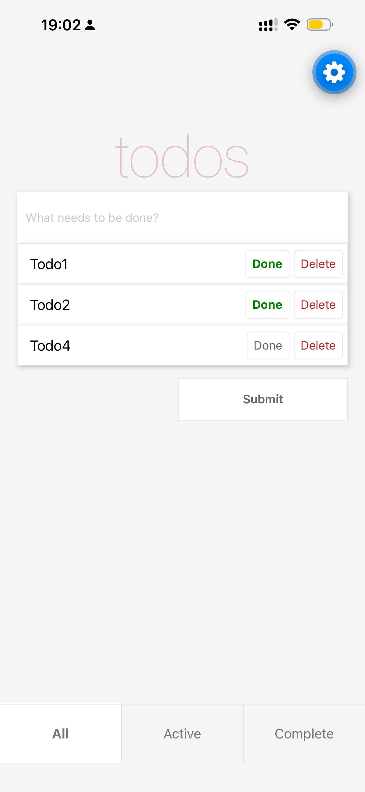
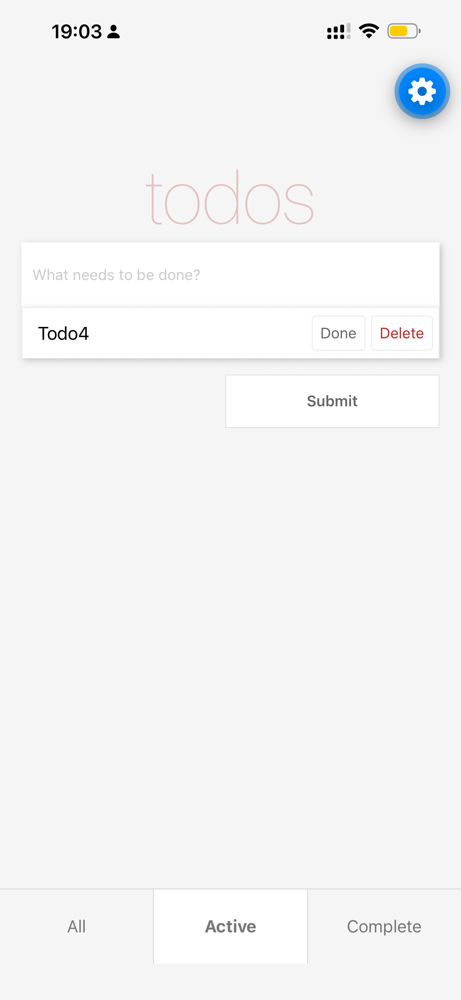
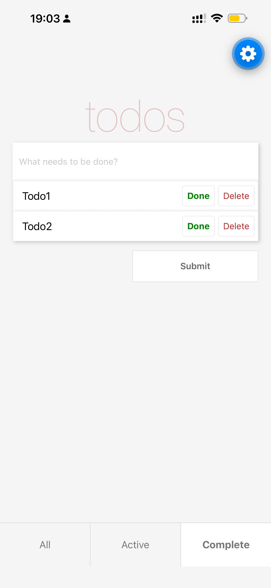
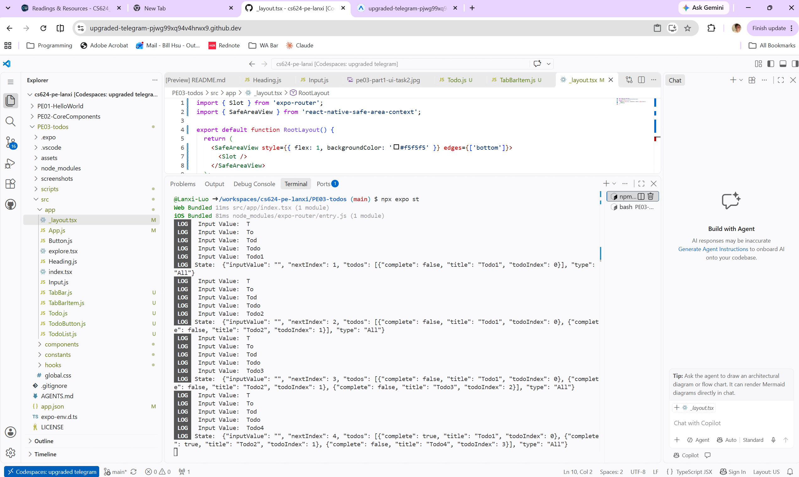
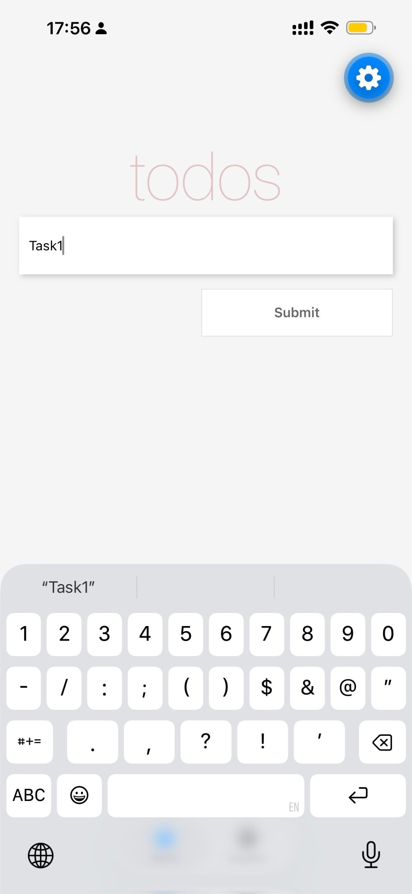
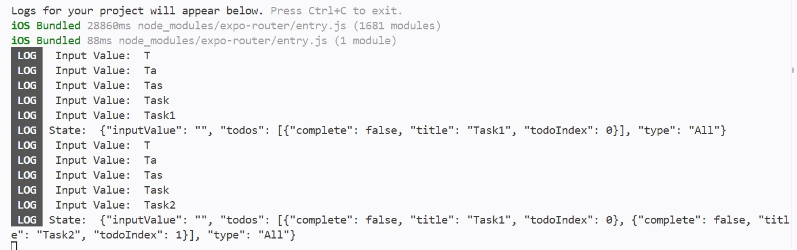

# Input

Same as Part 1, the user types a task and taps Submit. Now there's more to tap, though - Done and Delete on each todo, plus three tabs at the bottom: All, Active, and Complete.

# Process

App keeps inputValue, todos, type, and nextIndex in state. Following the PE03 feedback, submitTodo uses the functional form of setState, and nextIndex replaces the old top-level todoIndex variable. toggleComplete and deleteTodo build new arrays with map() and filter() instead of changing the old ones. Tapping a tab calls setType, then TodoList's getVisibleTodos uses a switch to return all, complete, or active todos. I also swapped the template's _layout.tsx for a plain Slot so its Home/Explore tabs don't cover the TabBar.

# Output

The list re-renders to match the selected tab, which turns bold with a white background. The terminal logs each keystroke and the updated state after every submit.

## Part 2

## Part 1

