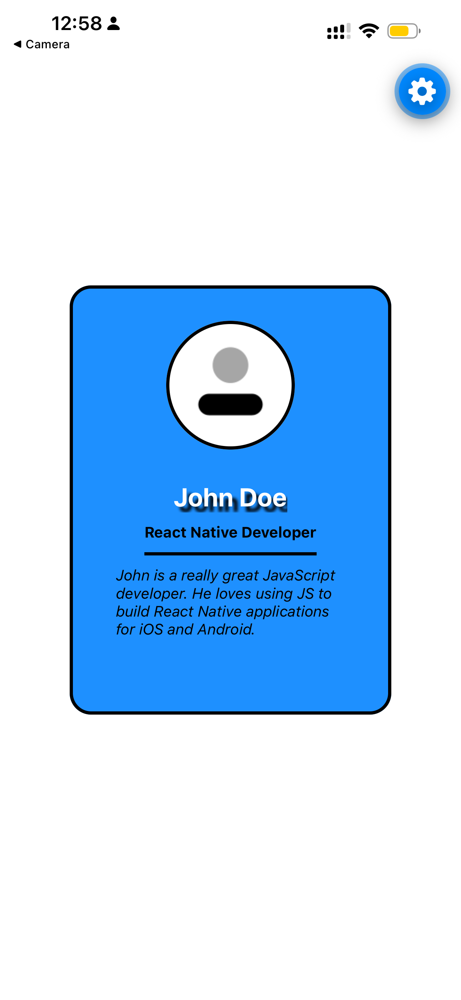
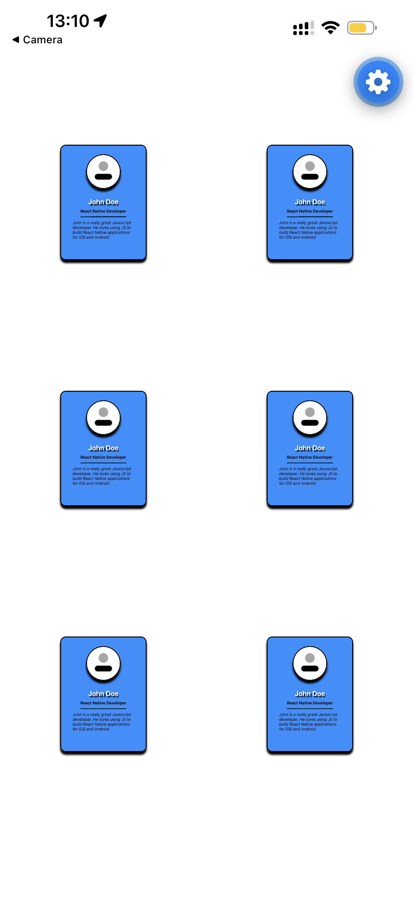
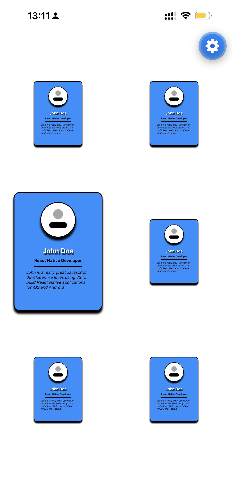

# Input

Each profile card gets its data as props - an image, a name, an occupation, a short description, and a showThumbnail flag. In Part 2 the data array just holds six copies of the same profile, and the user's only input is a tap on a card.

# Process

Part 1 is mostly styling - a circular image box, a line under the occupation, a text shadow on the name. Part 2 reuses the HOS06 card but lays six of them out with flexDirection: 'row' and flexWrap: 'wrap', each cell 50% wide so two fit per row. Tapping calls handleProfileCardPress, which uses update() to flip that card's showThumbnail. I put the scale transform on TouchableHighlight - a scaled card still takes its full 300x400 space, so otherwise the touch area wouldn't shrink with it.

# Output

Part 1 shows one finished card. Part 2 starts as a 2 x 3 grid of thumbnails, and a tapped card grows in place, then shrinks back.

## Part 1

## Part 2

