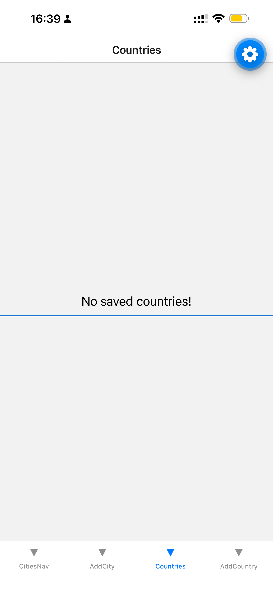
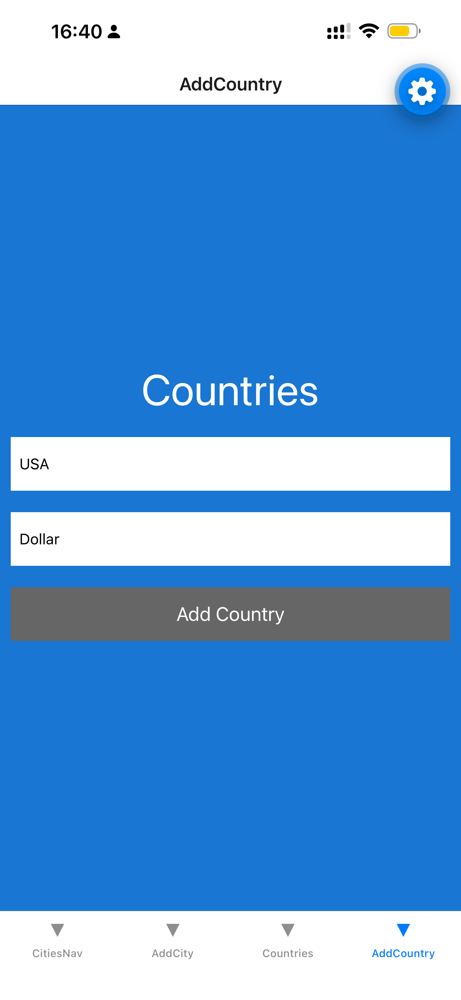
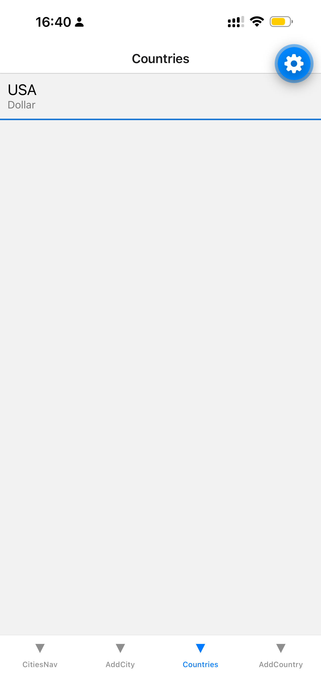
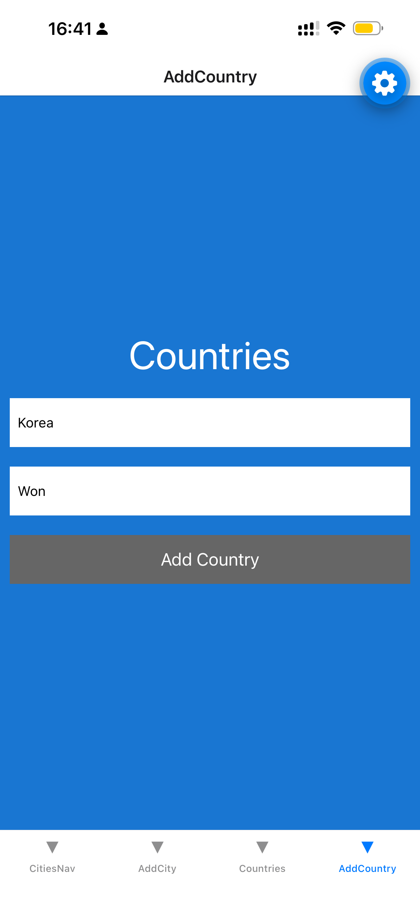
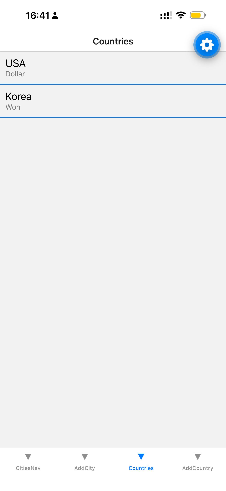

# Input

The user types a country name and its currency in the AddCountry tab. Each value goes into a TextInput. Both values are saved in state with useState as they are being typed.

# Process

On button press of "Add Country", the submit() function is called. This function first validates for required fields. If any of the fields are empty, it brings up an alert asking the user to fill out the form. After that, a country object is created with a unique id using react-native-uuid. Next, addCountry() in App.js receives this object and adds it to the countries list in state. Once that is done, both input fields are cleared and the Countries tab is opened through navigate('Countries').

# Output

The countries array is given to the Countries tab as a prop. In case the array is empty, the message "No saved countries!" shows up in the middle of the screen. Otherwise, every country is shown in a list, with the name of its currency in grey underneath. There are four tabs in the bottom tab navigator now: CitiesNav, AddCity, Countries and AddCountry.

## Screenshots

| Figure 1. Initial Screen with four tabs | Figure 2. The AddCountry Tab | Figure 3. The Countries Tab |
|---|---|---|
|  |  |  |

| Figure 4. The AddCountry Tab | Figure 5. The Countries Tab |
|---|---|
|  |  |